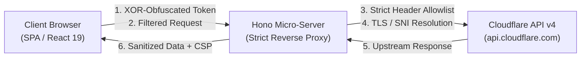
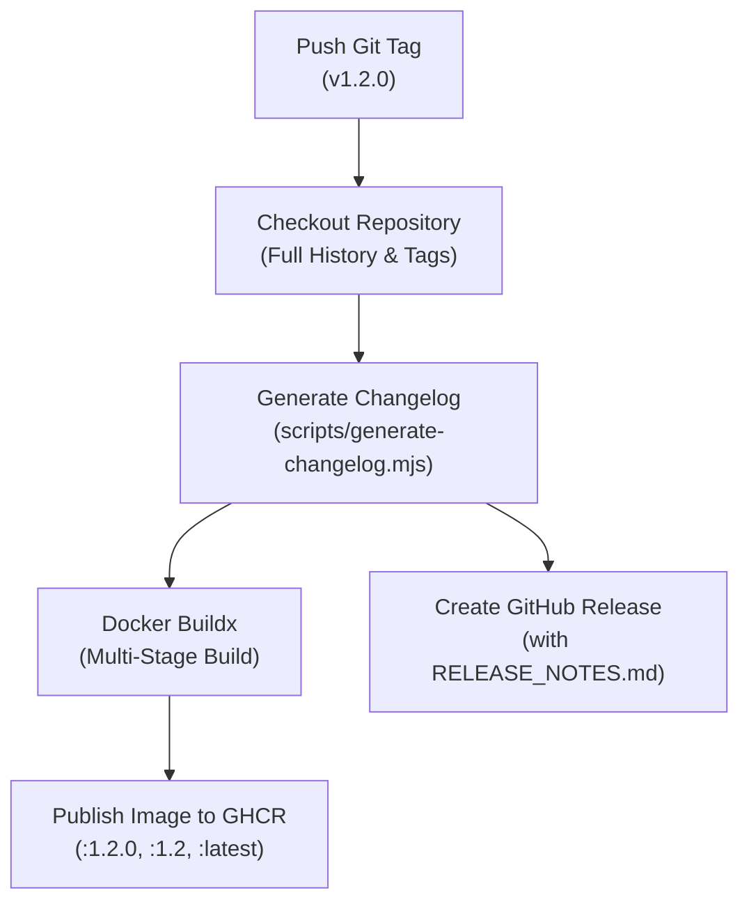

<div align="center">

# 🛡️ Cloudflare Rule Browser

**Next-generation, ultra-fast dashboard for inspecting, searching, editing, and bulk-managing Cloudflare IP Access Rules across accounts and all zones.**

[](https://react.dev/)
[-646cff?style=flat-square&logo=vite)](https://vite.dev/)
[](https://tailwindcss.com/)
[](https://hono.dev/)
[](https://www.typescriptlang.org/)
[](https://www.docker.com/)
[](https://github.com/aerzjee/cloudflare-rule-browser/pkgs/container/cloudflare-rule-browser)
[](LICENSE)

[Key Features](#-key-features) • [Security Architecture](#-security-architecture) • [API Permissions](#-cloudflare-api-token-permissions) • [Getting Started](#-getting-started) • [Docker Deployment](#-docker--ghcr-deployment) • [GitHub Pages & CORS Proxy](#-static-hosting-on-github-pages--cors-proxy) • [CI/CD Pipeline](#-automated-cicd-pipeline)

</div>

---

## 📖 Overview

**Cloudflare Rule Browser** is a high-performance web dashboard tailored for DevOps, SecOps, and network engineers managing Cloudflare IP Access Rules. Standard Cloudflare dashboards can be cumbersome when auditing thousands of IP rules spread across hundreds of domains and accounts.

Cloudflare Rule Browser unifies rule exploration into a lightning-fast, reactive single-page application with offline-capable IndexedDB storage, multi-threaded API ingestion, inline rule editing, bulk actions, and a hardened reverse-proxy architecture.

---

## ✨ Key Features

### 🌐 Account-Level & All-Zones Modes
- **Account-Wide Scope**: Query and manage rules defined at the Cloudflare Account level (`/accounts/{account_id}/firewall/access_rules/rules`).
- **Automatic Zone Discovery**: In All-Zones mode, the application automatically enumerates all active domains within your Cloudflare account and aggregates zone-level firewall rules into a single consolidated view.
- **Scope Differentiation**: Distinct badges clearly distinguish whether a rule is enforced globally across the Account or scoped to a specific Zone (domain).

### ⚡ High-Performance Local Cache (1,000+ Rules)
- **IndexedDB Persistence (`idb-keyval`)**: Stores thousands of normalized rules locally on the client. After the initial sync, rule browsing, multi-column sorting, and complex regex/substring filtering operate with zero network latency.
- **Instant Local Updates**: Modifications and deletions update the IndexedDB cache immediately, ensuring zero UI stutter or waiting time for slow roundtrips.
- **Cache Invalidation & TTL**: Automatically flags stale data and re-syncs in the background.

### ✏️ Inline Editing & Bulk Operations
- **Inline Action / Mode Selector**: Change rule modes (`block`, `challenge`, `js_challenge`, `managed_challenge`, `bypass`) directly from the table row using a glassmorphic dropdown with smooth micro-interaction feedback.
- **Inline Note Editor**: Update rule comments/notes on the fly with automatic keyboard bindings (`Enter` to save, `Esc` to cancel).
- **Batch Selection & Bulk Delete**: Multi-select rules across pages with a floating bulk action bar, visual selection counter, and a safe confirmation modal showing target IP identifiers before executing deletions.

### 🚀 Multi-Threaded Pagination & Smart Auto-Refresh
- **Configurable Concurrency (`p-limit`)**: Accelerate rule fetching using 1 to 6 parallel worker threads. Large accounts with thousands of rules sync in seconds.
- **Live Countdown Badge**: A dedicated navbar badge displays real-time seconds remaining until the next automatic synchronization, with a hover tooltip revealing the exact timestamp of the last successful refresh.
- **First-Page Delta Sync**: Rather than performing slow full downloads, background polling checks page 1 (`order=created_on&direction=desc`) to identify newly created rules and merge them into the local cache with minimal API quota consumption.

### 🎨 Modern Glassmorphism UI & i18n
- **Design System**: Frosted-glass aesthetics crafted with Tailwind CSS v4, CSS backdrop filters, and refined dark/light color schemes.
- **Fluid Layout Transitions**: Seamless row insertion, removal, and sorting powered by `motion` and `@formkit/auto-animate`.
- **Built-in Changelog Viewer**: Click the version badge in the navbar to open an interactive modal showing chronological Git release notes and categorized commit logs.
- **Internationalization (i18n)**: Fully typed bilingual support for **English** (default) and **Polish**, switchable at any time from the Settings modal.

---

## 🔒 Security Architecture

Cloudflare Rule Browser was engineered following zero-trust principles and defensive coding standards:



### 1. Hono Micro-Server as a Secure Reverse Proxy
Direct browser-to-Cloudflare API communication fails due to browser CORS restrictions and TLS SNI certificate negotiation constraints. Cloudflare Rule Browser embeds a dedicated Node.js micro-server built with **Hono**:
- Proxies requests under `/api/cf/*` to `https://api.cloudflare.com/client/v4/*`.
- Completely decouples client browsers from direct upstream Cloudflare endpoints.
- Isolates network traffic and prevents unauthorized cross-origin requests.

### 2. Strict Header Allowlist
The proxy enforces an explicit allowlist of headers:
```typescript
const allowedHeaders = ['authorization', 'x-auth-email', 'x-auth-key', 'content-type']
```
All internal headers, cookies, host identifiers, and untrusted client headers are stripped before dispatching requests to Cloudflare. Upstream error responses sanitize internal infrastructure messages before returning them to the client.

### 3. Client-Side Data Obfuscation & Ephemeral Sessions
API tokens and credentials stored in browser storage are masked using an XOR-based cipher. By default, Cloudflare Rule Browser runs in **Ephemeral Session** mode using `sessionStorage`—credentials vanish as soon as the browser tab is closed. Users can optionally opt in to "Remember session on this device" to persist credentials in `localStorage`.

### 4. Inactivity Auto-Lock & Zero-Trace Eviction
To guard against unattended workstations, an activity watcher monitors user input (`mousemove`, `keydown`, `scroll`, `touchstart`):
- Automatically disconnects and locks the session after a configurable timeout (default 30 min, customizable to 15, 30, 60 min, or disabled).
- Instantly purges Zustand memory stores, clears TanStack React Query caches, and wipes all indexed firewall rule databases from IndexedDB.
- Displays an alert banner on the login screen explaining the timeout eviction.

### 5. Pre-Flight Credential & Scope Verification
Before granting access to the Dashboard, the login flow validates credentials against Cloudflare API endpoints:
- In **Account Level Only** mode: Probes `GET /accounts` to ensure the token is active and valid.
- In **All Zones** mode: Probes `GET /zones` to confirm both token validity and required `Zone: Read` permissions.
- Prevents invalid tokens from loading broken or empty dashboards.

### 6. Hardened Content Security Policy (CSP)
Every HTTP response is delivered with strict security headers:
- `default-src 'self'`
- `connect-src 'self'`
- `script-src 'self'` (strictly prohibits `'unsafe-eval'` and external script execution)
- `style-src 'self' 'unsafe-inline'`
- `object-src 'none'`
- `base-uri 'self'`

### 7. Unprivileged Container Execution
The Docker image runs under the built-in, unprivileged `node` user (`UID 1000`) rather than `root`, mitigating container escape risks in shared container orchestration environments.

### 6. Zero-Trace Logout
Clicking **Disconnect** executes a complete wipe of the active session:
- Memory state in Zustand stores is reset.
- IndexedDB rule databases are deleted.
- LocalStorage keys (`cf-app-auth`, `cf-rules-cache`) are erased.
- Navigation redirects immediately to the authentication landing page.

---

## 🔑 Cloudflare API Token Permissions

Cloudflare Rule Browser strictly adheres to the **Principle of Least Privilege**.

### Recommended: Scoped API Token

Generate an API Token in the [Cloudflare Dashboard](https://dash.cloudflare.com/profile/api-tokens) (`My Profile` > `API Tokens` > `Create Token` > `Create Custom Token`) with the following permissions:

| Scope | Resource | Permission | Purpose |
| :--- | :--- | :--- | :--- |
| **Account** | `Account Firewall Access Rules` | **Read** / **Edit** | Query, update, and delete rules at the Account level. |
| **Zone** | `Zone` | **Read** | Discover active domains/zones (required for *All Zones* mode). |
| **Zone** | `Zone Firewall Access Rules` | **Read** / **Edit** | Query, update, and delete rules applied to specific zones. |

> [!NOTE]
> If you only plan to manage account-level firewall rules and check **Account level only** on the login screen, the `Zone` permissions can be completely omitted.

### Alternative: Global API Key (Legacy)
For legacy configurations, you may authenticate using your Cloudflare account **Email** and **Global API Key**. The proxy forwards `X-Auth-Email` and `X-Auth-Key` headers securely.

---

## 🛠️ Getting Started

### Prerequisites
- **Node.js**: `v22.0.0` or higher
- **npm**: `v10.0.0` or higher (bundled with Node.js)
- **Git**

### Installation

Clone the repository and install dependencies using `npm ci`:

```bash
git clone https://github.com/aerzjee/cloudflare-rule-browser.git
cd cloudflare-rule-browser
npm ci
```

### Development Mode

Start the Vite development server with built-in API proxying:

```bash
npm run dev
```

Open [http://localhost:5173](http://localhost:5173) in your browser.

### Linting & Code Quality

Validate the codebase using the ultra-fast `oxlint` linter:

```bash
npm run lint
```

### Production Build & Local Preview

Build the optimized SPA bundle and launch the Hono production server:

```bash
# Build the project (generates changelog, runs tsc, bundles with Vite Rolldown)
npm run build

# Launch the production Hono server on port 3000
npm run start
```

Or run the all-in-one preview script:
```bash
npm run preview:prod
```

Navigate to [http://localhost:3000](http://localhost:3000) to inspect the production release.

---

## 🐳 Docker & GHCR Deployment

Cloudflare Rule Browser is packaged as a minimal, multi-stage Alpine Docker image and published to the GitHub Container Registry (GHCR).

### Running via Docker CLI

```bash
docker run -d \
  --name cloudflare-rule-browser \
  -p 3000:3000 \
  --restart unless-stopped \
  ghcr.io/aerzjee/cloudflare-rule-browser:latest
```

Open [http://localhost:3000](http://localhost:3000) in your browser.

### Production `docker-compose.yml`

Create a `docker-compose.yml` file on your server:

```yaml
services:
  cloudflare-rule-browser:
    image: ghcr.io/aerzjee/cloudflare-rule-browser:latest
    container_name: cf-rule-browser
    restart: unless-stopped
    ports:
      - "3000:3000"
    environment:
      - NODE_ENV=production
      - PORT=3000
    healthcheck:
      test: ["CMD", "wget", "--spider", "-q", "http://localhost:3000/api/health"]
      interval: 30s
      timeout: 5s
      retries: 3
      start_period: 5s
    deploy:
      resources:
        limits:
          cpus: "1.0"
          memory: 256M
        reservations:
          memory: 64M
    security_opt:
      - no-new-privileges:true
```

Start the service:

```bash
docker compose up -d
```

Verify that the container is healthy:

```bash
docker compose ps
# Inspect health endpoint directly:
curl -i http://localhost:3000/api/health
```

### Building the Docker Image Locally

```bash
docker build -t cloudflare-rule-browser:local .
docker run -d -p 3000:3000 --name cf-local cloudflare-rule-browser:local
```

---

## 🌐 Static Hosting on GitHub Pages & CORS Proxy

GitHub Pages serves pure static assets without running a backend Node.js runtime. Direct browser calls to `api.cloudflare.com` are blocked by browser CORS policies. To run Cloudflare Rule Browser on GitHub Pages, configure an external CORS proxy endpoint.

### 1. Zero-Dependency Cloudflare Worker Proxy (`workers/cf-cors-proxy.ts`)
The repository includes a ready-to-deploy, standalone Cloudflare Worker in `workers/cf-cors-proxy.ts`:
- **Free Tier Compatible**: Runs smoothly within Cloudflare's 100,000 requests/day free allowance.
- **Strict Header Filtering**: Forwards only necessary authentication headers (`Authorization`, `X-Auth-Email`, `X-Auth-Key`, `Content-Type`, `Accept`).
- **CORS & Rate-Limit Propagation**: Returns required CORS preflight headers and exposes `ratelimit` / `ratelimit-policy` metrics to the frontend.
- **Built-in Origin Protection**:
  - Restricts access exclusively to authorized web origins to prevent your worker from being abused as an open proxy.
  - By default, the worker allows:
    ```typescript
    const DEFAULT_ALLOWED_ORIGINS = [
      'https://aerzjee.github.io',
      'http://localhost:5173',
      'http://localhost:3000',
    ]
    ```
  - Disallowed origins receive an immediate `403 Forbidden` JSON error (`{ success: false, errors: [{ code: 403, message: "Origin not allowed by CORS proxy" }] }`).
  - Wildcard (`*`) origin is never permitted; matching origins are echoed explicitly via `Access-Control-Allow-Origin: <origin>` with `Vary: Origin`.

#### Configuring Origin for Forks
If you fork this repository or deploy the worker under a custom domain, you can configure your allowed origins without modifying code:
- **Cloudflare Dashboard (Recommended)**:
  1. Go to **Workers & Pages** -> select your worker (`cf-cors-proxy`).
  2. Navigate to **Settings** -> **Variables and Secrets**.
  3. Add an Environment Variable named `ALLOWED_ORIGINS`.
  4. Set its value to your domain or a comma-separated list of domains:
     ```text
     https://<your-github-username>.github.io,http://localhost:5173
     ```
  5. Click **Save and Deploy**.
- **Or Edit Source Code**:
  Update `DEFAULT_ALLOWED_ORIGINS` directly in `workers/cf-cors-proxy.ts` before running `npx wrangler deploy`.

#### Deploying the Worker:
- **Via Wrangler CLI**:
  ```bash
  npx wrangler deploy workers/cf-cors-proxy.ts --name cf-cors-proxy --compatibility-date 2024-01-01
  ```
- **Via Cloudflare Dashboard**:
  1. Open **Workers & Pages** -> **Create Application** -> **Create Worker**.
  2. Paste the contents of `workers/cf-cors-proxy.ts` into the quick editor and deploy.
  3. Configure the `ALLOWED_ORIGINS` environment variable under Worker Settings if hosting on your own GitHub Pages domain.
  4. Note your assigned worker URL (e.g. `https://cf-cors-proxy.<subdomain>.workers.dev`).

### 2. Automated GitHub Pages Deployment (`deploy-pages.yml`)
When a version tag (`v*`) is pushed or manually triggered via **Actions** -> **Deploy to GitHub Pages** -> **Run workflow**:
1. Full Git history is checked out to parse commits into `changelog.json`.
2. Vite builds the static app with relative asset paths (`base: './'`).
3. An optional repository variable `VITE_API_PROXY_URL` (configured in **Settings** -> **Secrets and variables** -> **Actions** -> **Variables**) can be set to bake your default proxy endpoint (e.g. `https://cf-cors-proxy.<subdomain>.workers.dev/api/cf`) directly into the build.
4. The `./dist` directory is uploaded and deployed to GitHub Pages (`https://<username>.github.io/<repo>/`).

### 3. Configuring the Proxy Endpoint in the UI
If `VITE_API_PROXY_URL` was not baked during build time, you can set it directly on the login screen:
- When hosted on `*.github.io`, the login view highlights the **Advanced / Proxy Endpoint** expandable panel.
- Enter your worker URL (e.g. `https://cf-cors-proxy.<subdomain>.workers.dev/api/cf`) or an external Hono instance.
- The setting is saved in your local session and can be updated or reset at any time.

---

## 🚀 Automated CI/CD Pipeline

The project includes a GitHub Actions workflow (`.github/workflows/release-ghcr.yml`) for automated testing, tagging, and Docker publishing:



When a semver tag (e.g. `v1.2.0`) is pushed to GitHub:
1. **Changelog Generation**: `scripts/generate-changelog.mjs` computes the delta between tags, categorizes commits (`feat`, `fix`, `perf`, `docs`), and writes `RELEASE_NOTES.md` and `src/generated/changelog.json`.
2. **Metadata Injection**: `APP_VERSION` and `GIT_COMMIT` build arguments are passed into the Docker build stage.
3. **Multi-tag Publication**: The container image is published to `ghcr.io/aerzjee/cloudflare-rule-browser` with semantic version tags (`1.2.0`, `1.2`, and `latest`).
4. **GitHub Release**: A formal GitHub Release is published with the generated Markdown notes attached.

---

## 🗂️ Project Structure

```
cloudflare-rule-browser/
├── .github/workflows/         # GitHub Actions (release-ghcr.yml, deploy-pages.yml)
├── public/                    # Static public assets and favicons
├── scripts/
│   └── generate-changelog.mjs # Git commit parser & changelog generator
├── server/
│   └── index.ts               # Hono reverse proxy & static asset server
├── workers/
│   └── cf-cors-proxy.ts       # Cloudflare Worker zero-dependency CORS proxy
├── src/
│   ├── api/                   # Cloudflare API integration (accessRules.ts)
│   ├── components/
│   │   ├── layout/            # Navbar, settings modal, changelog modal
│   │   ├── rules/             # Table, bulk bar, inline note/mode editors
│   │   └── ui/                # Glassmorphic UI components & progress bars
│   ├── hooks/                 # Custom React hooks (React Query, mutations)
│   ├── i18n/                  # Typed translations (en, pl) & translation hook
│   ├── store/                 # Zustand state stores (auth, settings, rules)
│   ├── utils/                 # IndexedDB cache manager (idb-keyval), crypto
│   ├── App.tsx                # App entrypoint with lazy loading & Suspense
│   └── main.tsx               # DOM mount point
├── Dockerfile                 # Multi-stage production container definition
├── index.html                 # HTML shell
├── package.json               # Dependencies & scripts
├── tsconfig.json              # TypeScript configuration
└── vite.config.ts             # Vite 8 config with Rolldown code-splitting
```

---

## 📄 License

This project is open-source software licensed under the [MIT License](LICENSE).
